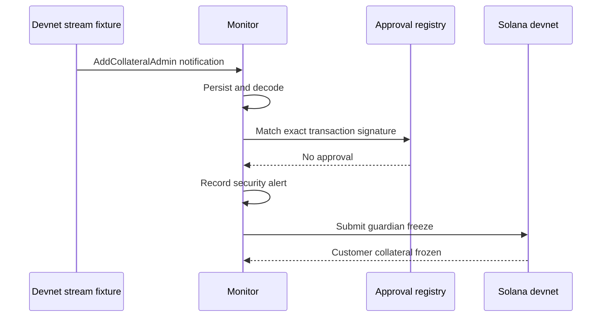

# Parsed Streams security monitor

Detect an unauthorized collateral-admin insertion and freeze only the affected
customer's account. The monitor demonstrates Parsed Streams filtering,
reconnects, historical recovery, and exact-signature approvals.

> [!WARNING] The on-chain program intentionally omits authorization in
> `add_collateral_admin`. Use devnet only. This bug is the attack demonstrated
> by the example.

The walkthrough uses real devnet transactions and a **local WebSocket fixture**
that emits Parsed Streams-shaped notifications. It does not connect devnet to
the mainnet Helius stream. The optional read-only smoke command checks the real
service separately. See the [design](docs/design.md) and
[historical devnet proof](docs/live-devnet-proof.md).



## Prerequisites

Follow [native setup](../docs/setup.md) for Node, pnpm, Rust, and the Solana
CLI. The devnet fixture needs no Helius API key or public tunnel.

Run the following commands from `parsed-streams-monitor/`:

```sh
pnpm install --frozen-lockfile --ignore-scripts
pnpm build
pnpm demo --help
```

## Configuration

Create separate devnet keys outside the checkout:

```sh
export DEMO_HOME="$HOME/.config/helius-security-demo/parsed-streams"
mkdir -p "$DEMO_HOME"
for role in deployer program customer attacker guardian approved-admin; do
  solana-keygen new --no-bip39-passphrase --silent --outfile "$DEMO_HOME/$role.json"
done
cp .env.example "$DEMO_HOME/demo.env"
```

Edit that external file. Keep `STREAM_MODE=fixture`.

| Variable                               | Value                                                                               |
| -------------------------------------- | ----------------------------------------------------------------------------------- |
| `RPC_URL`                              | Devnet RPC with WebSocket support                                                   |
| `COLLATERAL_PROGRAM_ID`                | Output of `solana-keygen pubkey "$DEMO_HOME/program.json"`                          |
| `DEPLOYER_KEYPAIR`, `PROGRAM_KEYPAIR`  | Absolute paths to `deployer.json`, `program.json`                                   |
| `CUSTOMER_KEYPAIR`, `ATTACKER_KEYPAIR` | Absolute paths to `customer.json`, `attacker.json`                                  |
| `BOT_KEYPAIR`                          | Absolute path to `guardian.json`                                                    |
| `DB_PATH`                              | An absolute SQLite path, shared by CLI and bot, such as `$DEMO_HOME/monitor.sqlite` |
| `FIXTURE_PORT`, `STREAM_URL`           | Matching local port and URL; the example uses `3100` and `ws://127.0.0.1:3100`      |
| `COLLATERAL`                           | Leave empty until initialization prints the address                                 |

[Fund the devnet roles](../docs/setup.md#keys-and-funding). The approved admin
only needs a public key for this scenario. Load the external file in **every
terminal** used below:

```sh
set -a
source "$HOME/.config/helius-security-demo/parsed-streams/demo.env"
set +a
```

## Deploy and initialize

Set `COLLATERAL_LAMPORTS` in your shell to your chosen positive integer deposit
in lamports before running:

```sh
pnpm deploy:devnet
pnpm demo init "$COLLATERAL_LAMPORTS"
```

Choose `COLLATERAL_LAMPORTS` as a positive integer deposit in lamports.
Initialization pays account rent separately and prints `export COLLATERAL=...`.
Run that export and save the address in the external environment file.

```sh
pnpm demo state
pnpm demo withdraw "$WITHDRAWAL_LAMPORTS"
```

Expected: unfrozen collateral and a confirmed withdrawal by the customer. Choose
a positive withdrawal amount within the spendable balance.

## Start monitoring

1. **Terminal 1:** load the environment and run `pnpm fixture`.
2. **Terminal 2:** load the environment and run `pnpm bot`.
3. **Terminal 3:** load the same environment and run the scenarios below.

The bot subscribes, recovers missed transactions, and processes live events. Its
JSON logs identify subscriptions, recovered events, alerts, and freezes.

## Scenarios

**Approved admin insertion.** Register the new admin before broadcasting:

```sh
pnpm demo approved-add "$(solana-keygen pubkey "$HOME/.config/helius-security-demo/parsed-streams/approved-admin.json")"
pnpm demo jobs
pnpm demo state
```

Expected: an `approved` job and `frozen: false`. The CLI and bot must use the
same `DB_PATH`. Each admin can only be added once.

**Recovery and containment.** Stop the fixture in Terminal 1, leaving the bot
running. In Terminal 3:

```sh
pnpm demo attack-add
```

Restart `pnpm fixture` in Terminal 1. The bot reconnects, recovers the missed
insertion from devnet history, emits an alert, and freezes the account:

```sh
pnpm demo wait-frozen
pnpm demo expect-frozen-withdraw
pnpm demo jobs
pnpm demo alerts
```

Expected: a durable alert, a frozen account, and an on-chain `Frozen` error from
the attacker's withdrawal. The collateral balance stays unchanged.

**Account isolation.** A different customer's collateral has its own guardian
and freeze state. The
[historical proof](docs/live-devnet-proof.md#account-isolation) shows a
successful control-account withdrawal after the victim was frozen.

**Atomic attack.** Stop the fixture and bot. Initialize a fresh account with
`pnpm demo init "$COLLATERAL_LAMPORTS"`, update `COLLATERAL` in your terminal
and environment file, then run:

```sh
pnpm demo attack-atomic
```

Expected: the admin insertion and withdrawal succeed atomically, draining the
spendable balance before a stream event can trigger a freeze. To monitor another
fresh account, restart both the fixture and bot with its new address.

## Limitations

- Monitoring cannot interrupt an atomic transaction or undo funds already moved.
  Separate withdrawals can also beat the response.
- Reconnect recovery closes historical gaps after service returns; it cannot
  protect funds while the monitor is offline.
- A missed approval or compromised guardian can cause a one-way freeze. The
  separate upgrade authority can replace the program.
- Alerts are local structured records; no pager, email, or chat integration is
  included.

For the real-service smoke check and mainnet adapter details, see
[Helius service integration](docs/helius-service.md). For local tests and
`--json` output, see [development](../docs/development.md).
