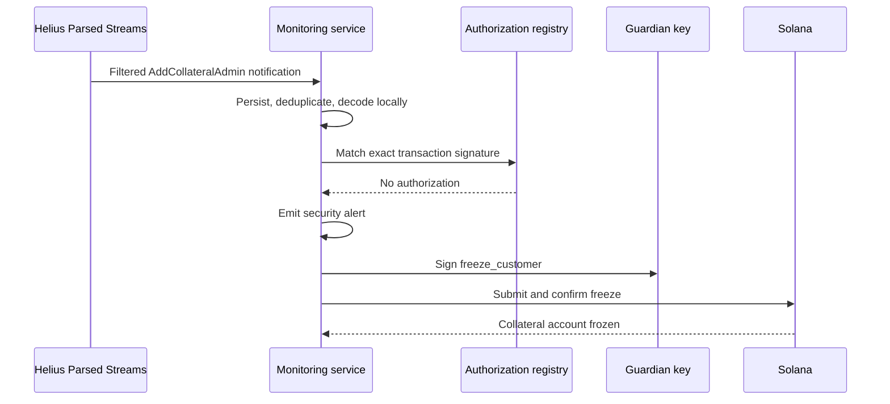

# Parsed Streams security monitor

A Rain-inspired customer-collateral demo that detects an unauthorized
`AddCollateralAdmin` instruction with Helius Parsed Streams and freezes only the
affected customer account.

See [the live devnet proof](docs/live-devnet-proof.md) for public deployment,
recovery, freeze, control-account, and atomicity transactions.

> [!WARNING]
> The on-chain program intentionally contains an authorization bug in
> `add_collateral_admin`. Use devnet only and keep balances small.

## What it demonstrates

The customer collateral PDA stores SOL, a fixed guardian, and up to four admin
keys. Its `add_collateral_admin` instruction deliberately omits an existing
admin's authorization check. Anyone can append an admin, reproducing the
vulnerability class described in the article.

The monitor subscribes to Parsed Streams with this filter:

```json
{
  "programs": ["<COLLATERAL_PROGRAM_ID>"],
  "accounts": { "include": ["<COLLATERAL>"] },
  "includeFailed": false,
  "includeCpi": true
}
```

The custom program is outside Helius's IDL catalog, so it arrives as raw
instruction data. The monitor decodes tag `1`, verifies the collateral account
and proposed admin, and checks the exact transaction signature against the
local approval registry. An unapproved insertion emits a structured security
alert and immediately submits a guardian-only freeze transaction.



## Delivery and recovery

Parsed Streams delivery is at most once. The client tracks the last reconciled
slot durably, reconnects with exponential backoff, and resubscribes after
disconnects. After every subscription it:

1. Buffers live notifications.
2. Reconciles transactions in the missed slot window.
3. Persists and deduplicates recovered events.
4. Advances the durable slot.
5. Processes buffered live notifications.

Devnet recovery uses `getSignaturesForAddress` and `getParsedTransaction` over
the configured RPC. The mainnet production adapter uses the paginated Helius
Parsed Events transaction-history endpoint. The client also applies the
documented 60-second inactivity watchdog.

Helius Parsed Streams and Parsed Events are served from mainnet endpoints.
Consequently, the devnet end-to-end run uses `src/fixture-server.mjs`, a local
WebSocket server that emits Parsed Streams-shaped notifications from confirmed
devnet transactions. It exercises the same subscription parser, SQLite store,
approval lookup, alerting, freeze transaction, reconnect, and recovery logic.
The read-only smoke command verifies the real service separately.

## Build and test

Use Node 22.13 or newer, the pinned pnpm version, and a Rust toolchain
compatible with `Cargo.lock`. Inside the managed Codex workspace:

```sh
pnpm install --frozen-lockfile --ignore-scripts
pnpm test
cargo test --locked
bash scripts/build-sbf.sh
BPF_OUT_DIR=target/deploy cargo test --locked --test collateral
```

The build script verifies the pinned Anza platform-tools archive before
extracting it. The artifact is `target/deploy/rain_collateral_guard.so`.

## Configure devnet

Copy `.env.example` to an external file and load it into the shell. Keep every
keypair outside this checkout. The managed workspace already provides the demo
deployer, customer, attacker, guardian, and the dedicated
`demo-collateral-program` identity through its wallet registry.

Required development variables include:

| Variable | Purpose |
| --- | --- |
| `RPC_URL` | Devnet RPC URL |
| `COLLATERAL_PROGRAM_ID` | Deployed collateral program address |
| `COLLATERAL` | The current victim collateral PDA |
| `DEPLOYER_KEYPAIR` | External deployment authority |
| `PROGRAM_KEYPAIR` | External program identity |
| `CUSTOMER_KEYPAIR` | Customer and initial collateral admin |
| `ATTACKER_KEYPAIR` | Attacker used by the malicious commands |
| `BOT_KEYPAIR` | Fixed guardian used for freeze transactions |
| `DB_PATH` | SQLite approval, job, alert, and reconciliation state |
| `FIXTURE_PORT` | Local devnet fixture port |

Deploy the independent program:

```sh
bash scripts/deploy-devnet.sh
```

Create and fund a fresh account, then put the printed address in
`COLLATERAL`:

```sh
node src/cli.mjs init 20000000
node src/cli.mjs state
```

## Run the devnet proof

Start the protocol fixture in one terminal:

```sh
node src/fixture-server.mjs
```

Use a configuration with `STREAM_MODE=fixture` and point `STREAM_URL` at the
fixture's printed `ws://127.0.0.1:<port>` URL. Start the guardian in a second
terminal:

```sh
node src/bot.mjs
```

Exercise an approved admin insertion. The bot records the exact transaction
signature before broadcast and must not freeze:

```sh
node src/cli.mjs approved-add "$LEGITIMATE_ADMIN_PUBLIC_KEY"
node src/cli.mjs jobs
node src/cli.mjs state
```

For recovery and containment, stop the fixture and submit an unapproved admin
insertion while disconnected:

```sh
node src/cli.mjs attack-add
```

Restart the fixture. The bot reconnects, reconciles the missed devnet slot
window, emits an unauthorized-admin alert, freezes the collateral account, and
records the result:

```sh
node src/cli.mjs wait-frozen
node src/cli.mjs expect-frozen-withdraw
node src/cli.mjs jobs
node src/cli.mjs alerts
```

`expect-frozen-withdraw` submits the attacker's withdrawal on-chain and requires
the `Frozen` custom error and an unchanged collateral balance. A second
collateral account can be initialized under a different customer; freezing the
first account does not affect the second.

On another fresh account, demonstrate the remaining race:

```sh
node src/cli.mjs attack-atomic
```

The insertion and withdrawal execute atomically before any confirmed stream or
recovery event can respond. Parsed Streams cannot intervene between those
instructions.

## Mainnet service smoke test

The smoke test is read-only. It calls `describeProgram` for Jupiter, subscribes
to Jupiter `route` instructions over the real Parsed Streams endpoint, prints
one public signature and slot, and exits. It does not submit a mainnet
transaction.

Provide `HELIUS_API_KEY` through the external environment; the key is never
printed or persisted by the project.

```sh
HELIUS_API_KEY=... pnpm smoke
```

Use `STREAM_MODE=parsed`, a mainnet `RPC_URL`, the mainnet Parsed Events URL,
and an externally supplied API key only when running the production recovery
adapter against a real mainnet deployment.

## Boundaries

- A compromised guardian can freeze customer accounts incorrectly, and a lost
  guardian key removes the automatic freeze capability.
- The upgrade authority can replace the program and bypass its rules.
- Parsed Streams delivery, WebSocket uptime, and recovery API availability affect
  detection latency. Historical recovery happens after a disconnect and cannot
  undo funds moved before the gap.
- An admin insertion and withdrawal in one transaction cannot be interrupted.
- A missed legitimate authorization in the registry causes a false positive and
  a one-way freeze.
- Alerts are durable structured local records. No Slack, email, or pager
  integration is included.
