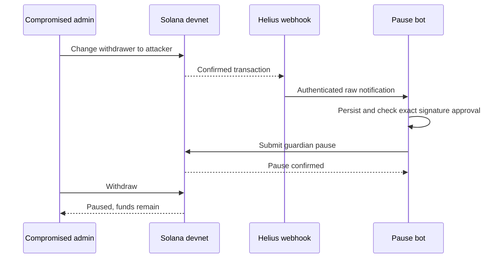

# Webhook security monitor

Detect an unapproved change to a Solana vault's withdrawer with a real Helius
raw webhook, then pause the vault using a separate guardian key.

The demo models a compromised application admin. The guardian can stop
withdrawals but cannot move funds, change the withdrawer, or undo a pause. See
the [design](docs/design.md) and
[historical devnet proof](docs/live-devnet-proof.md).



## Prerequisites

Follow [native setup](../docs/setup.md) for Node, pnpm, Rust, and the Solana
CLI. You also need a Helius account and public HTTPS access to the receiver; the
included tunnel helper can provide a temporary URL.

Run the following commands from `webhook-monitor/`:

```sh
pnpm install --frozen-lockfile --ignore-scripts
pnpm build
pnpm demo --help
```

## Configuration

Create separate devnet keys outside the checkout:

```sh
export DEMO_HOME="$HOME/.config/helius-security-demo/webhook"
mkdir -p "$DEMO_HOME"
for role in deployer program admin withdrawer attacker guardian; do
  solana-keygen new --no-bip39-passphrase --silent --outfile "$DEMO_HOME/$role.json"
done
cp .env.example "$DEMO_HOME/demo.env"
```

Edit that external file. Keep `SENDER_ENABLED=0` and `ALLOW_MAINNET=0`.

| Variable                              | Value                                                                               |
| ------------------------------------- | ----------------------------------------------------------------------------------- |
| `RPC_URL`                             | Devnet RPC with WebSocket support                                                   |
| `PROGRAM_ID`                          | Output of `solana-keygen pubkey "$DEMO_HOME/program.json"`                          |
| `DEPLOYER_KEYPAIR`, `PROGRAM_KEYPAIR` | Absolute paths to `deployer.json`, `program.json`                                   |
| `ADMIN_KEYPAIR`, `WITHDRAWER_KEYPAIR` | Absolute paths to `admin.json`, `withdrawer.json`                                   |
| `ATTACKER_KEYPAIR`, `BOT_KEYPAIR`     | Absolute paths to `attacker.json`, `guardian.json`                                  |
| `DB_PATH`                             | An absolute SQLite path, shared by CLI and bot, such as `$DEMO_HOME/monitor.sqlite` |
| `WEBHOOK_AUTH`                        | A secret value you also configure in the Helius dashboard                           |
| `PORT`                                | Receiver port; the example uses `3000`                                              |
| `VAULT`                               | Leave empty until initialization prints the address                                 |

[Fund the devnet roles](../docs/setup.md#keys-and-funding), then load the file
in **every terminal** used below:

```sh
set -a
source "$HOME/.config/helius-security-demo/webhook/demo.env"
set +a
```

## Deploy and initialize

Set `VAULT_LAMPORTS` in your shell to your chosen positive integer deposit in
lamports before running:

```sh
pnpm deploy:devnet
pnpm demo init "$VAULT_LAMPORTS"
```

Choose `VAULT_LAMPORTS` as a positive integer deposit in lamports.
Initialization pays account rent separately and prints `export VAULT=...`. Run
that export in your terminal and save the address in the external environment
file.

```sh
pnpm demo state
pnpm demo withdraw "$WITHDRAWAL_LAMPORTS"
```

Expected: an active vault and a confirmed withdrawal by the initial withdrawer.
Choose a positive withdrawal amount within the spendable balance.

## Start monitoring

1. **Terminal 1:** load the environment and run `pnpm bot`.
2. **Terminal 2:** load the environment and run `pnpm tunnel`. Keep it running.
3. In the [Helius dashboard](https://dashboard.helius.dev), create a **Devnet**,
   **Raw** webhook monitoring `VAULT`. Set its URL to the tunnel's HTTPS URL
   plus `/webhook`, and its authorization value to `WEBHOOK_AUTH`.
4. **Terminal 3:** load the same environment and run the scenarios below.

The bot logs received notifications and confirmed pauses as JSON. It stores
notifications before acknowledging them and resumes unfinished jobs after a
restart. Confirm successful deliveries in the Helius dashboard.

## Scenarios

**Approved update and donation.** Use the initial withdrawer's public key for
this approved update, then send a positive integer donation:

```sh
pnpm demo approved-change "$(solana-keygen pubkey "$WITHDRAWER_KEYPAIR")"
pnpm demo donate "$DONATION_LAMPORTS"
pnpm demo jobs
pnpm demo state
```

Expected: the update is `approved`, the donation is `irrelevant-or-failed`, and
`paused` remains `false`. Approval is recorded before broadcast in the same
`DB_PATH` used by the bot.

**Attack without containment.** Stop the bot. Create a fresh vault with
`pnpm demo init "$VAULT_LAMPORTS"` and update `VAULT` in your terminal and file:

```sh
pnpm demo attack-change
pnpm demo drain
```

Expected: the attacker drains the spendable balance, leaving rent.

**Attack with containment.** Initialize another fresh vault, update `VAULT`,
restart the bot with the new address, and update the Helius webhook's monitored
account:

```sh
pnpm demo attack-change
pnpm demo wait-paused
pnpm demo expect-paused
pnpm demo jobs
```

Expected: the bot pauses the vault; the attempted withdrawal fails on-chain with
`Paused`, and the vault balance stays unchanged. Waiting for the pause proves
functional containment after it lands, not that the bot wins every race.

**Atomic attack.** Initialize another fresh vault and update `VAULT`:

```sh
pnpm demo attack-atomic
```

Expected: the admin change and withdrawal succeed in the same transaction,
before any webhook can trigger a response.

## Limitations

- Webhooks arrive after confirmation. They cannot reverse a withdrawal or
  intervene between instructions in one transaction. Separate transactions can
  also outrun the bot.
- Missing deliveries, unavailable RPC, or insufficient guardian funds can
  prevent a pause.
- A false positive or compromised guardian can lock funds permanently under this
  program. The separate upgrade authority can replace the program.
- The attacker controls the admin key, not the approval registry or bot host.

For optional mainnet routing, see [Sender Max](docs/sender.md). For local checks
and `--json` output, see [development](../docs/development.md).
